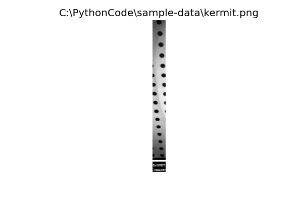

Inspect images, pixels and metadata
***********************************

.. currentmodule:: Stoner.Image

Use ``im`` for an image created in :doc:`image` or loaded with
``im = ImageFile("my_image.png")``. Pixel slices and metadata keys use
different forms of indexing.

ImageFile Attributes and Properties
===================================

The key attributes and properties of the :class:`ImageFile` are:

    - :py:attr:`ImageFile.image`:
        This is the native Dataset. Use ``imarray`` for a read-only NumPy copy of the pixels, with their mask.
    - :attr:`ImageFile.metadata`:
        This is the dictionary that contains the metadata associated with the image. This is normally parameters and
        information about the measurement or data that is encoded within the the measurement file, but can be supplemented
        by information added by the user directly or by methods and functions. Each item of metadata is normally referred to by a string *key*.
    - :attr:`ImageFile.filename`:
        This is the name of the file from which the image was loaded (as a string). It is also used as a default title when
        displaying the image.
    - :attr:`ImageFile.mask`:
        This represents the mask data for an image file. By default it is entirely False, meaning all parts of the image
        are visible. It supports a variety of different ways of manipulating which parts of the image are masked - see the section
        below.
    - :attr:`ImageFile.draw`:
        This is a special attribute that lets you draw simple geometric shapes on the image.

:class:`ImageFile` objects use the appropriate data type for the underlying image format - integers for PNG and either integers or
floating point numbers for tiffs (STXM files are always floating point).

The :meth:`ImageFile.convert` method can be used to convert the data to a more appropriate format::

    im.convert(float)
    im.asfloat()
    im.asint()

It also has simpler :meth:`ImageFile.asfloat` and :meth:`ImageFile.asint` methods for converting to floating point or integer
formats as required.

There are a number of other attributes that can tell you information about the :class:`ImageFile` such as:

    - :attr:`ImageFile.centre`:
        the coordinates of the centre of the image
    - :attr:`ImageFile.aspect`:
        the image aspect ratio
    - :attr:`ImageFile.shape`:
        the image height and width in pixels, in that order.

To make it easier to quickly get a rotated image, the attributes :attr:`ImageFile.CW` and :attr:`ImageFile.CCW` return
copies of the :class:`ImageFile` that are rotated 90 degrees clockwise and anticlockwise, respectively.

In many cases the default behaviour of modifying the image data in place may not be desired - to get a copy of the
:class:`ImageFile` you use the :attr:`ImageFile.clone` attribute::

    new_im = im.clone.gaussian(4.0) # create a copy of im and then apply a gaussian blur

Rectangular array slices return an independent :class:`ImageFile` containing
that part of the image. Editing the result does not change the original::

    section = im[:, 10:50]  # A vertical section of the image.

::

	im[::-1,:] # Flip the image vertically

Indexing an :class:`ImageFile` with a string will instead access the metadata stored with the object::

    im["Loaded as"]
    >>> 'KermitPNGFile'

The :class:`ImageFile` inherits from a dictionary like class - so all the usual Python dictionary methods work on the
metadata of the image::

    for metadata_key in im:
        print(f"{metadata_key} -> {im[metadata_key]}")

    averages = im.pop("Averages",1)
    if "Message" in im:
        print(f"Message = {im['Message']}")

Like the :class:`Stoner.core.data.Data` class, the metadata dictionary will fall back to matching keys with regular expressions
if not exact match is found. In this case, if multiple metadata items match then the result of indexing with a string
may return a dictionary with all the matching keys.

The metadata associated with an image will always be stored in the best Python type that can be found - where possible
metadata is stored in files with a hint as to the native type of that data and this type hint is used to map to an
appropriate Python type. Unmappable types are retained as a string representation.

For numerical exports and editing blocks, see :doc:`image_interchange`.
