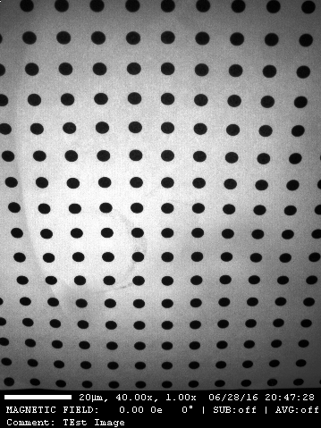

Load and save images
********************

.. currentmodule:: Stoner.Image

Create an :class:`ImageFile` from a filename or a two-dimensional NumPy array.
Examples using ``kermit.png`` refer to the image in the repository
``sample-data`` directory; replace it with your own filename as needed.

The :class:`ImageFile` constructor supports taking a string argument which is interpreted as a filename of an image format recognised by PIL. The resulting
image data is used to form the contents of the :attr:`ImageFile.image` which holds the image data::

   from Stoner import ImageFile
   im = ImageFile("kermit.png")

Like :class:`Stoner.core.data.Data`, :class:`ImageFile` supports image metadata. Where this can be stored in the file, e.g. in PNG and TIFF images, this is read in
automatically. This metadata is stored as a :class:`Stoner.core.base.TypeHintedDict` dictionary. This metadata can be set directly in the
construction of the :class:`ImageFile`::

   import numpy as np
   im = ImageFile(np.arange(10000).reshape(100,100), metadata={'myarray':1})

Saving an image
===============

Use ``im.save("processed.png")`` or ``im.save("processed.tif")`` to save
pixels and supported metadata. PNG and TIFF support embedded Stoner metadata.
The filename suffix selects the output format.

ImageFile Representation
========================

By default, the representation of an ImageFile is just a short textual description. However, if the *short_repr* and *short_img_repr* options
are both set to False and a graphical console is in use with an IPython kernel, then the special ``_repr_png_`` method will show a picture of the
contents of the ImageFile instead::

    i = ImageFile("kermit.png")
    i
    >>> kermit.png(<class 'Stoner.Image.core.ImageFile'>) of shape (479, 359) (uint16) and 53 items of metadata
    from Stoner import Options
    Options.short_repr=False
    Options.short_img_repr=False
    i
    >>>

Supported formats and methods
=============================

As well as the wrapped scikit-image and scipy.ndimage functions, :class:`ImageFile` provides a set of its own functions for
carrying out some common image processing operations.

By default :class:`ImageFile` can load and save both .tiff and .png files and will embed its metadata into custom tags in those
formats.

Subclasses of the :class:`ImageFile` are provided for reading the .png files produced by the CM group's Evico Kerr Microscopes as well as
the :func:`Stoner.formats.image.hdf5.load_stxm_image` loader, which reads STXM images from the SLS Pollux beamline.

Continue with :doc:`image_inspecting` or :doc:`image_plotting`.
