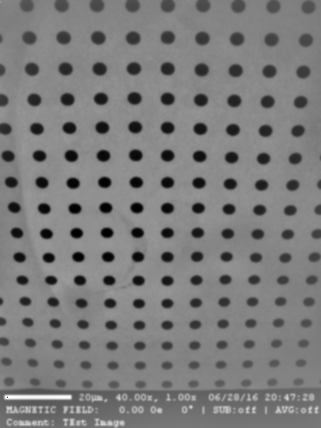
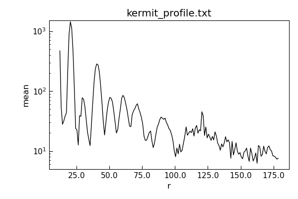

Filter images and analyse spatial frequencies
*********************************************

.. currentmodule:: Stoner.Image

Start with an ImageFile named ``im``. Many processing methods change it
in place and return the image for chaining. Use ``im.clone`` before
processing when you need to keep the original measurement.

Contrast Normalisation
======================

If the absolute value of the image data is not important, then normalising the image can improve the contrast. The
:meth:`ImageFile.normalise` will do this.By default it will remap the image intensity values to the range -1 to +1. This
can be changed with the *scale* keyword parameter. The area of the image used to calculate the mapping between the old and
new intensity values can be set with the *sample*  parameter. If there are a few pixels with extreme values in the image then
this can reduce the contrast for the bulk of the image. By using the *limits* parameter you can restrict the portion
of the input range to be rescaled over. For example, *limits=(0.1,0.9)* will map the first 10% and the last 10% of the
pixels to -1 or +1 and the middle 80% between the two extremes::

    im.normalise(limits=(0.01,0.99))

Image Filtering
===============

Filtering is frequently used to remove noise and other artefacts from images. Most of the filters that can be applied are
functions within the scikit-image.filters module. A good general purpose option is to use a gaussian filter - this will
convolute the image with a 2-D gaussian function with a user-definable width. This is effective for removing high frequency
noise and speckle::

    im.gaussian(1.0)

For band-pass filtering the scikit-image.filters method *difference_of_gaussians* can be used. This filters the image with two
different gaussian blurs and then takes the difference between them - the smaller gaussian blur removes high frequency noise
whilst the large gaussian removes low spatial frequency variations::

    im.difference_of_gaussians(1.0,2.0)

Another filtering approach is to use a Savitzky-Golay filter - this fits a polynomial surface locally over the data to smooth
or differentiate the data. This sort of filtering is good for preserving feature sizes in the original data set::

    im.sgolay2d(points=5)

Fourier transforms
==================

Fast Fourier transforms are often used when we need to examine the frequency spectra of image data. The :meth:`ImageFile.fft`
method provides a convenient one-stop method for generating the FFT that can also take care of some of the artefacts that
can result::

    fft=im.clone.fft(remove_dc=True, window="hamming")

In this example, a copy of the image is transformed to the magnitude of its Fourier transform. The Fourier transform is shifted
so that the central pixels are the zero-frequency components. The optional keyword *remove_dc* replaces the 0 frequency data with the
mean value of the FFT to avoid a large spike in the FFT from the mean value of the image. The *window* parameter tells the method
to multiply the image by the corresponding window function (from scikit-image.filters.window) before calculating the FFT. This
avoids artefacts caused by the discontinuities at the edges of the image.

The shifting of the FFT to align the dc components to the centre of the image can be controlled with the *shift* keyword
parameter, whilst the output is controlled by the *phase* parameter - False gives the magnitude, True returns the phase angle in radians
and None returns the full complex FFT.

To aid with analysing radial distributions in FFTs (or images), the :meth:`ImageFile.radial_profile` method can be used.
This will compute a profile from a given centre outwards - either integrating over all angles, or restricting to specific angles.
At its simplest one can just do::

    profile=fft.radial_profile()

This returns a :class:`Stoner.core.data.Data` object with columns for the lower, central and upper
radial bin positions, mean pixel value, standard deviation and number of pixels counted.
Angles are in radians. The optional *angle* keyword parameter will select either one angle (float) or a
range of angles (a tuple of two floats). This can be easily plotted since the :class:`Stoner.core.data.Data` object is created with the
appropriate columns setup as x and y data columns::

    ax = fft.radial_profile(angle=(-0.04, 0.04)).plot()
    ax.set_yscale("log")

Further functions
=================

Further functions that could be useful:

  - im.threshold_minmax(0.2,0.8)
      Returns a binary image
  - im.plot_histogram()
      Plot a histogram of the pixel intensities
  - im.level_image()
      Flatten a skewed image background
  - im.subtract_image(otherim)
      Subtract another image and enhance contrast
  - im.align(otherim)
      Translate image to line up with other im

Scikit-Image & scipy.ndimage Functions
======================================

While many local analysis functions have been added to ImageFile one of the big benefits is that function proxy methods have been added to make the entire
scikit-image library and scipy routines available. Function requests will first search local image functions and secondly look up any function from the external
libraries. The wrapper supplies numerical image pixels to the external function; you do not
need to pass the native Dataset yourself. The return value for such
calls is handled a bit carefully:

    #. If the return value is a 2d numpy.ndarray like type that has the same size as the original, or if the *_* keyword argument is set to **True** then the original
        :attr:`ImageFile.image` is replaced with the returned result.
    #. If the return value is anything else then it is simply passed back to the calling program.

In this way, many operations can be carried out 'in-place' on a :class:`ImageFile`.
