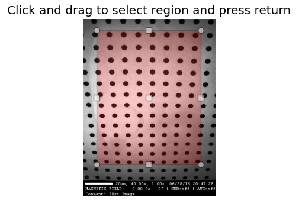

Measure, crop and align images
******************************

.. currentmodule:: Stoner.Image

These examples use an ImageFile named ``im``. Alignment also needs a
reference image named ``ref`` with the same scene. For a managed region
of interest and interactive selection, see :doc:`image_roi`.

Measuring part of an image
==========================

Use ``where`` for a calculation on selected pixels without changing the image
or its mask. ``True`` means include that pixel. The selection must have exactly
the image's shape::

    import numpy as np

    region = np.zeros(im.shape, dtype=bool)
    region[:, :2] = True  # The first two columns.
    background = im.mean(where=region)
    corrected = im.to_numpy() - background

The mean ignores masked pixels and non-finite values. An empty selection returns
NaN. This calculation leaves the persistent mask unchanged; clearing an existing
mask later reveals the original measurement.

For a stack, ``imst.average(where=region)`` similarly needs a Boolean selection
with shape ``(number_of_frames, height, width)``. Repeat a spatial selection across
frames explicitly when needed. Padding outside each image's valid size is always
ignored, and output pixels with no usable observations are masked NaNs.

Experienced xarray users can supply a Boolean DataArray instead, with exactly
matching dimensions and coordinates. Implicit expansion and mismatched
coordinates are rejected. Direct xarray calculations do not automatically apply
Stoner's mask.

``where`` is supported by these reductions, not by neighbourhood filters such as
a Gaussian blur. To filter a rectangular region, make a crop first. Filtering a
crop treats its edges as image boundaries, so it can differ from filtering the
whole image and then selecting a region.

Specify a box
=============

Many of the functions can be used with a *_box* parameter to limit their operation to a specified region of the image.
Additionally the :meth:`ImageFile.crop` method will discard the image outside a region specified in a similar way. The
working box can be given as follows:

    - A single integer:
        This is interpreted to exclude a region of n pixels from all sides of the image.
    - A single floating point number between 0.0 and 0.5:
        This is interpreted to exclude this corresponding fraction of the width and height from each side of the image
    - A tuple of 4 numbers, or 4 arguments:
        This is interpreted as a sequence of pixel coordinates for (left-x, right-x, top-y, bottom-y). If any of the
        numbers are None, then this is take as the minimum or maximum extents of the width or height (depending on whether
        the None value substitutes for the left, right top or bottom coordinate).
    - A single string:
        The argument is interpreted as the name of a metadata item that will define the box to be used.
    - A single value False:
        This is equivalent to the whole image (i.e. to not specify a box)
    - A single None value:
        In this case a copy of the image is shown to the user and they are invited to draw the box with the mouse and
        then press the <Enter> key to confirm their selection.

Aligning Two Images
===================

The :func:`Stoner.Image.imagefuncs.align` function, exposed as the ``ImageFile.align`` method, can be used to align an image to a reference image. It offers a variety of different
algorithms which may be better or worse depending on the nature of the image. The options are:

    - chi2_shift:
        this uses the image-registration module to carry out a chi-squared analysis of shifting the two images
        relative to each other.
    - imreg_dft:
        this uses the imreg_dft module to carry out the image registration. In essence it takes a Fourier transform
        of the two images and then compares the phases within the Fourier transforms to calculate the necessary shift.
    - scharr:
        this is the default method used. It first of all applies a Scharr edge detection filter and uses the
        imreg_dft method to find the translation vector.
    - cv2:
        this method uses the opencv2 package's alignment algorithm.

Align also takes a *_box* keyword parameter to confine the section of the image used for the alignment to a specific region
(this can make the operation more efficient  if much of the images are featureless), and a *scale* parameter that will upscale
the image before attempting to do the alignment. This may improve sub-pixel alignment corrections.

As well as returning the shifted image, :meth:`ImageFile.align` will record the translation vector used in the metadata item *tvec*::

    im.align(ref,method="imreg_dft", scale=4)
    print(f"Translation Vector={im['tvec']}")

Align also calculates a *translation_limits* metadata item that represents the maximum extent of the image where the pixels
have not been added to accommodate the translation for the alignment.

Cropping an Image
=================

The :meth:`ImageFile.crop` method selects a rectangular region. By default it
changes ``im`` to refer to that region and returns ``im``. To keep the original
image unchanged and obtain an independent cropped image, use::

    cropped = im.crop(10, 50, 20, 80, copy=True, _=None)

Here ``_=None`` requests a separate ImageFile and ``copy=True`` makes its pixels
independent. Without ``copy=True``, the region shares pixels and masks with the
original, so editing it can change the original. Ordinary rectangular slicing,
such as ``im[20:80, 10:50]``, is a simpler way to make an independent crop.

With no box arguments, ``crop`` displays the image so that you can draw a region;
press Enter to accept it. The same copying options apply.

The combination of the *translation_limits* metadata item from the :meth:`ImageFile.align` method and the specification of the box
for cropping allows images to be aligned and then cropped to match::

    im.align(ref,method="imreg_dft", scale=4)
    # Crop the image according to the translation limits worked out be align.
    cropped = im.crop("translation_limits", copy=True, _=None)

    # Now crop the reference image, using the reversed translation limits
    cropped_ref = ref.crop(im.translation_limits("tvec", reverse=True), copy=True, _=None)
